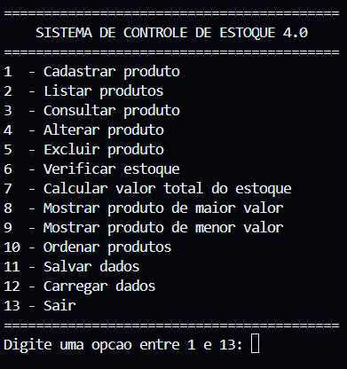
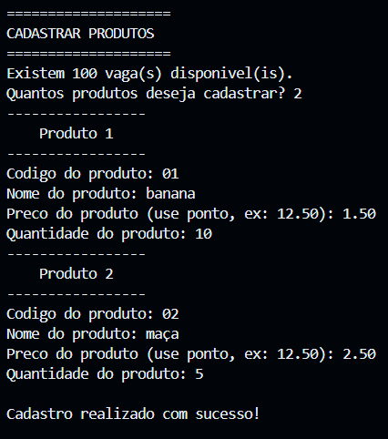
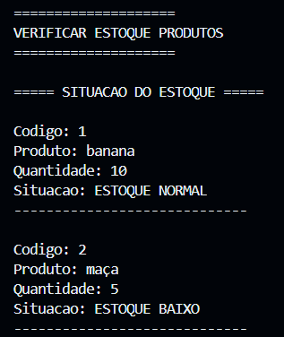

# 📦 Sistema de Controle de Estoque 4.0

Sistema de gerenciamento e controle de estoque desenvolvido em linguagem C, como parte dos estudos em **Análise e Desenvolvimento de Sistemas (ADS)**.

O projeto tem como objetivo aplicar conceitos fundamentais de programação, lógica computacional, estruturas de dados, modularização e manipulação de arquivos, por meio de um sistema interativo de gerenciamento de produtos.

---

## 🚀 Funcionalidades

- [x] Cadastro de produtos.
- [x] Listagem de produtos cadastrados.
- [x] Consulta de produtos por código.
- [x] Alteração de informações dos produtos.
- [x] Exclusão de produtos.
- [x] Verificação da situação do estoque.
- [x] Cálculo do valor total do estoque.
- [x] Identificação do produto de maior valor em estoque.
- [x] Identificação do produto de menor valor em estoque.
- [x] Ordenação de produtos por código.
- [x] Salvamento de dados em arquivo TXT.
- [x] Carregamento de dados armazenados.

## 🛠️ Tecnologias e ferramentas

- **Linguagem:** C
- **Compilador:** GCC
- **Editor de código:** Visual Studio Code
- **Controle de versão:** Git e GitHub

## 🧠 Conceitos de programação aplicados

Durante o desenvolvimento, foram utilizados conceitos importantes:

- Estruturas de dados com `struct`.
- Vetores de estruturas.
- Funções e modularização.
- Ponteiros.
- Estruturas condicionais.
- Laços de repetição.
- Validação e tratamento de entradas.
- Manipulação de arquivos com `FILE`.
- Persistência de dados com `fopen()`, `fprintf()`, `fscanf()` e `fclose()`.
- Algoritmo de ordenação Bubble Sort.

## 📂 Estrutura do projeto

```text
sistema-controle-estoque-c/
│
├── main.c
├── produtos.txt
├── README.md
├── .gitignore
└── imagens/
    ├── menu-principal.png
    ├── cadastro-produtos.png
    └── controle-estoque.png
```

## 💻 Como executar o projeto

### 1. Clone o repositório

```bash
git clone https://github.com/gabrieljdsantos/sistema-controle-estoque-c.git
```

### 2. Entre na pasta do projeto

```bash
cd sistema-controle-estoque-c
```

### 3. Compile o programa

```bash
gcc -Wall -Wextra -std=c11 main.c -o estoque
```

### 4. Execute o sistema

**Windows:**

```bash
.\estoque.exe
```

**Linux:**

```bash
./estoque
```

## 📸 Demonstração

### Menu principal



### Cadastro de produtos



### Controle de estoque



## 📚 Objetivo acadêmico

Este projeto foi desenvolvido como atividade prática durante a formação em **Análise e Desenvolvimento de Sistemas (ADS)**, com foco no aprofundamento dos conhecimentos em linguagem C e no desenvolvimento de soluções computacionais.

O desenvolvimento foi realizado de forma incremental, incorporando novas funcionalidades e aprimorando a organização e a lógica do sistema a cada etapa.

## 👨‍💻 Autor

**Gabriel José dos Santos**

Estudante de Análise e Desenvolvimento de Sistemas (ADS), interessado em desenvolvimento de software, tecnologia e construção de soluções computacionais.

- 🐙 **GitHub:** [gabrieljdsantos](https://github.com/gabrieljdsantos)
- ✍️ **Dev.to:** [Meu perfil](https://dev.to/gabriel_jdsantos)
- 💼 **LinkedIn:** [Meu perfil](https://www.linkedin.com/in/gabrieljdsantos/)

---

⭐ Se este projeto despertou seu interesse, fique à vontade para explorar o código e acompanhar minha evolução como desenvolvedor.

**Desenvolvido com dedicação e aprendizado contínuo.** 💻